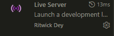
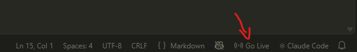

# SISTEMA-ACADEMICO 

##### Nome: Matheus Pedroso da Silva
##### RA: 2650832423004
##### Turma: Sistemas para Internet, 5º semestre

## Para executar o frontend

Para executar o frontend recomendasse o uso da extensão *Live Server*.



Com a pasta do projeto aberta, clique no botão *Go live* localizado no canto inferior direito da tela.



## Para executar o backend

- Acesse a pasta onde está localizado o projeto.

- Com o terminal aberto, acesse a pasta .\backend\

```
//Acessa a pasta backend
cd . \backend
```

- Execute o comando o abaixo para verificar se o npm está instalado, se não estiver, acesse este página: https://nodejs.org/pt-br/download para mais instruções de como baixar o npm. Com o npm instalado, execute o segundo comando para iniciar o backend.

```
//Verica a versao do npm
npm -v

//Executa o npm
npm run dev
```

## Endpoints disponíveis

http://localhost:3000/api/health

http://localhost:3000/api/alunos

## Evidências em: .\docs\evidencias

./sistema-academico-ds2/
└─/docs/
    └─evidencias/